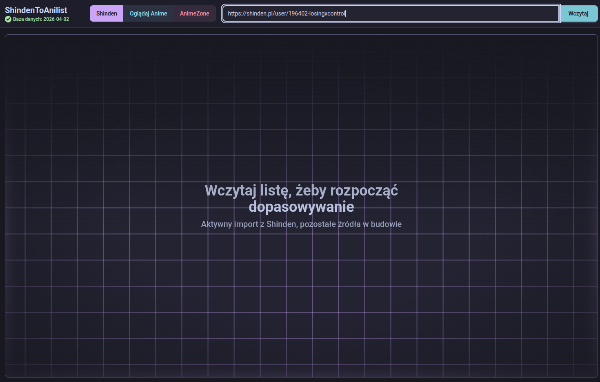
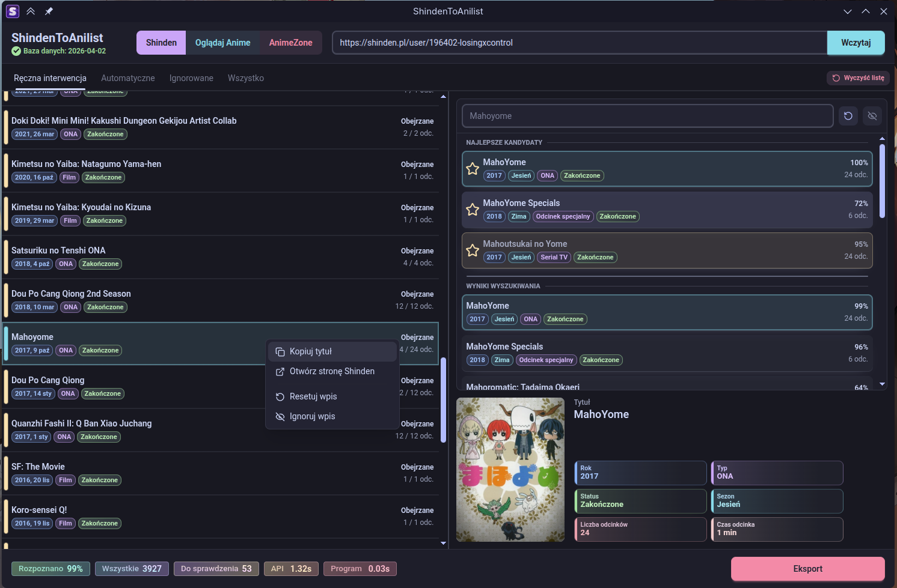

# ShindenToAnilist

> Eksportuj swoją listę z Shindena do pliku XML, który zaimportujesz do AniList albo MyAnimeList.

**ShindenToAnilist** to aplikacja desktopowa dla osób, które prowadzą swoją listę anime na
[Shindenie](https://shinden.pl), AnimeZone albo Oglądaj Anime i chcą przenieść ją do
[AniList](https://anilist.co/settings/import) albo [MyAnimeList](https://myanimelist.net/import.php).

Aplikacja pozwala przejrzeć albo ręcznie poprawić niepewne dopasowania, a na końcu zapisuje eksport
XML zgodny z MAL.

## Pobierz wersję 1.0.2 (x64)

[-0078D4?style=for-the-badge)][download-windows]
[][download-linux-tauri-appimage]
[-E95420?style=for-the-badge)][download-linux-tauri]
[][download-linux-electron]
[][download-linux-system-electron]

[download-windows]: https://github.com/Kacper-Kondracki/ShindenToAnilist/releases/download/v3-1.0.2/ShindenToAnilist-1.0.2-windows-x64-tauri.exe
[download-linux-tauri-appimage]: https://github.com/Kacper-Kondracki/ShindenToAnilist/releases/download/v3-1.0.2/ShindenToAnilist-1.0.2-linux-x64-tauri.AppImage
[download-linux-tauri]: https://github.com/Kacper-Kondracki/ShindenToAnilist/releases/download/v3-1.0.2/ShindenToAnilist-1.0.2-linux-x64-tauri
[download-linux-electron]: https://github.com/Kacper-Kondracki/ShindenToAnilist/releases/download/v3-1.0.2/ShindenToAnilist-1.0.2-x86_64-bundled.AppImage
[download-linux-system-electron]: https://github.com/Kacper-Kondracki/ShindenToAnilist/releases/download/v3-1.0.2/ShindenToAnilist-1.0.2-linux-x64-system-electron.AppImage

[Najnowsze wydanie na GitHubie](https://github.com/Kacper-Kondracki/ShindenToAnilist/releases/latest)

## Zrzuty ekranu

<table>
  <tr>
    <td>
      
    </td>
    <td>
      
    </td>
  </tr>
</table>

## Wydania

Gotowe paczki aplikacji są publikowane na stronie wydań:

<https://github.com/Kacper-Kondracki/ShindenToAnilist/releases>

> [!NOTE]
> W porównaniu ze starszą wersją nacisk jest
> położony na szybsze dopasowywanie tytułów, wygodniejszy interfejs desktopowy i ręczną korektę
> niepewnych wyników. Wprowadzono zupełnie nowy algorytm znajdujący dopasowania, zoptymalizowany pod
> wielowątkowość i dostrojony tak, żeby automatycznie znajdował jak najwięcej trafnych tytułów. Nikt
> nie lubi ręcznie męczyć się z tym :)

## Co robi aplikacja

1. Wczytuje listę anime z wybranego źródła: Shinden, AnimeZone albo Oglądaj Anime.
2. Pobiera i zapisuje lokalną bazę używaną do dopasowywania tytułów.
3. Automatycznie szuka najlepiej pasujących tytułów w bazie.
4. Pokazuje dopasowania i listę kandydatów.
5. Pozwala ręcznie wybrać lepsze dopasowanie, gdy automatyczny wynik nie wystarcza.
6. Eksportuje wybrane dopasowania do pliku XML.

> [!IMPORTANT]
> Wczytywanie list jest dostępne dla Shindena, AnimeZone i Oglądaj Anime. AnimeZone oraz Oglądaj
> Anime są pobierane przez scrapowanie stron, więc działają wolniej niż Shinden; Oglądaj Anime ma
> też ostre limity zapytań. Aplikacja wyciąga bezpośrednie linki do MAL-a tam, gdzie źródło je
> udostępnia, co ogranicza ręczne dopasowywanie.

## Import eksportu

Po wyeksportowaniu XML-a z aplikacji zaimportuj go na jednej z tych stron:

- AniList: <https://anilist.co/settings/import>
- MyAnimeList: <https://myanimelist.net/import.php>

## Logi diagnostyczne

Aplikacja zapisuje logi lokalnie w folderze użytkownika.

- Linux — `$XDG_STATE_HOME/ShindenToAnilist/logs`, domyślnie `~/.local/state/ShindenToAnilist/logs`
- Windows — `%LOCALAPPDATA%\ShindenToAnilist\logs`
- macOS — `~/Library/Logs/ShindenToAnilist`

`tauri.log` zawiera zdarzenia aplikacji Tauri. W wersji Electron `electron.log` zawiera zdarzenia okna i interfejsu, a `native.log` zdarzenia usługi Rust. Na początku sesji zapisywana jest wersja aplikacji i identyfikator commita, jeśli był dostępny podczas budowania. Każdy plik jest obracany po osiągnięciu 1 MiB. Poprzedni plik ma rozszerzenie `.log.1`.

## Dla developerów

Instrukcje deweloperskie znajdują się tu
[CONTRIBUTING.md](CONTRIBUTING.md). Opis granic modułów jest w [ARCHITECTURE.md](ARCHITECTURE.md).

## Licencja

Projekt jest dostępny na licencji [Mozilla Public License 2.0](LICENSE).

Baza anime jest pobierana z [cedya77/anime-offline-database](https://github.com/cedya77/anime-offline-database),
kontynuacji projektu [manami-project/anime-offline-database](https://github.com/manami-project/anime-offline-database).
Baza jest udostępniana na licencji ODbL 1.0, a jej zawartość na licencji DbCL 1.0.
